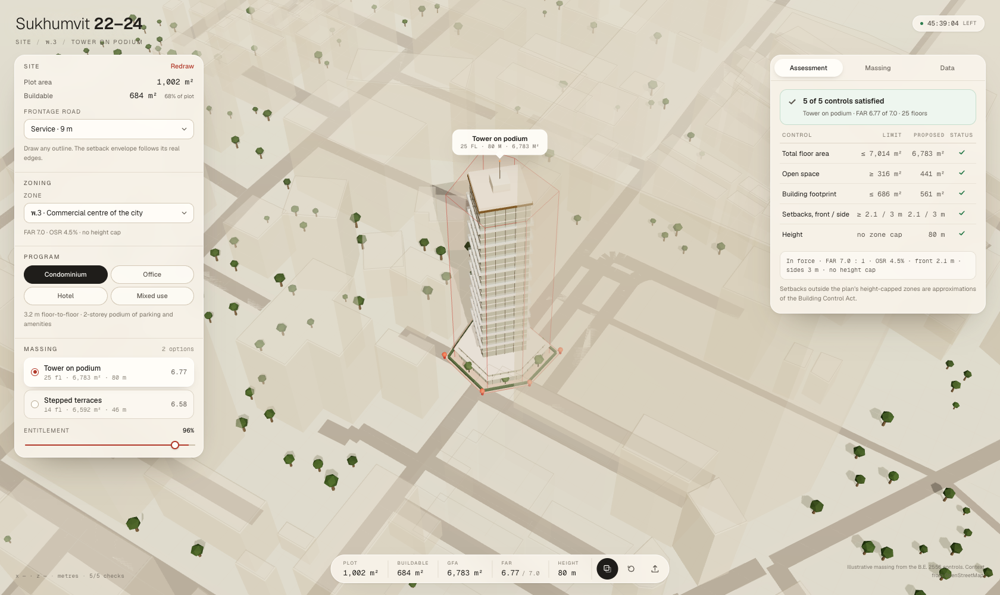

# Bangkok massing feasibility

**Live: [bangkok-massing.vercel.app](https://bangkok-massing.vercel.app/)**

A browser tool that answers one question for a Bangkok plot: **what can I build here, and what does it look like?**
Draw any plot outline on a real Sukhumvit block, pick the zone, the road it faces and a building type. The tool
resolves the plan's numeric controls into a buildable envelope cut from that real outline, then fits two concept
massings inside it, live, with a pass/fail reading against every control.



## What it does

- **Any plot shape.** Click corners on the ground; Enter closes. Every edge takes its own setback, so the envelope
  follows the real outline rather than a bounding box.
- **Real site.** 201 OpenStreetMap buildings and 100 roads around Sukhumvit 22–24, extruded with roofs, kerbs,
  centre-line paint and a few hundred trees. Context can be ghosted to read the site or shown solid.
- **Rules that drive geometry.** FAR, OSR, setbacks and height are computed once and feed both the mesh and the
  checklist, so the picture and the numbers cannot drift.
- **Two schemes.** Tower-on-podium and stepped terraces, each rounded to whole floors and never over entitlement.
- **Live.** Zone, program, road, plot and the entitlement slider re-solve everything with no reload.
- **Two drawings.** The 3D view, and an isometric envelope figure rendered from the same model.
- **Export.** One click writes the current view to a PNG.

## How the model works

1. **FAR** caps total floor area: `GFA ≤ plot × FAR`.
2. **OSR** is open space over *floor area*, not over land, so it caps the footprint:
   `footprint ≤ plot − GFA × OSR`.
3. **Setbacks** offset each edge of the real polygon: front from the right-of-way, sides and rear fixed. The inset is
   a per-edge miter offset, with health checks and a fallback for concave outlines.
4. **Height** is only capped in ย.1/ย.2. In commercial zones the plan caps floor area, so height is an outcome:
   `height ≈ GFA ÷ plate × floor-to-floor`. The tool makes that visible instead of hiding it behind a slider.
5. **Massing** fills the envelope to a chosen share of entitlement, then rounds to whole floors.

## Stack

| Layer | Choice | Why |
|---|---|---|
| Shell | Astro (static) | Almost no JS for the chrome; the only client bundle is the scene. |
| 3D | Three.js + OrbitControls | Extruded OSM footprints, real shadows, no tile server dependency. |
| Geometry | hand-written (`src/lib/geom.ts`) | Shoelace area, per-edge miter offset, convex hull, rotating-calipers minimum-area rectangle. No turf/clipper payload. |
| Rules | `src/lib/zoning.ts` | The B.E. 2556 FAR/OSR table, typed, with sources in comments. |
| Massing | `src/lib/massing.ts` | Two generators sharing one envelope. |
| Figure | `src/lib/iso.ts` | Isometric SVG of the same model, four-tone shading. |

First load: one static page, one JSON of site geometry, one JS chunk.

## Data

- Footprints, roads and names: OpenStreetMap via `api.openstreetmap.org` (ODbL), baked into `public/site.json`.
  The untouched response is in `data/osm-sukhumvit.xml`.
- Heights: OSM `height` / `building:levels` where tagged (15 of 201), otherwise estimated from footprint area with a
  seeded hash. The proposal's geometry never depends on them.
- Zoning: Ministerial Regulation B.E. 2556, the plan in force while the 4th revision sits in its public-display
  period.

## Honest limits

- The zone is **user-selected**, not read from the BMA GIS layer. Two plots on one soi can sit in different
  sub-areas (พ.3-1 … พ.3-43) with different prohibited uses; only the numeric controls are modelled.
- Setbacks outside the plan's own height-capped zones are approximations of the Building Control Act, labelled in
  the UI. They are deliberately independent of the modelled height so a setback never chases the height that
  chases the setback.
- Context heights are estimated where OSM has no tags.
- Not modelled: prohibited activities, parking minimums, fire access, the FAR bonus, the draft 4th revision.

## Run

```bash
npm install
npm run dev      # http://localhost:4321
npm run build
```

Layout: three columns above 1080 px; below that the scene keeps its height, a metric dock stays visible, and
Inputs / Assessment / Massing / Data become tabs.
